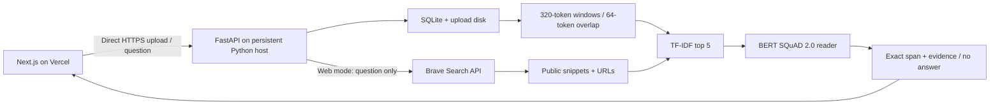

# Architecture

## Request paths

## Ingestion

Files are read with a 20 MB bound after multipart parsing; the hosting proxy should also enforce a total request limit. PDFs have a 500-page limit. Extracted text is limited to 2 million characters. ZIP-based EPUB/DOCX inputs have a 40 MB expanded-size and 5000-entry limit. Native text is supported; the optional Glypharis adapter is disabled pending an actual model release. EPUB follows spine order and POSIX archive paths. Text extraction preserves PDF page boundaries, but concatenates non-PDF formats into one logical section.

For image-bearing PDF pages with little native text, BookWorm can render bounded RGB images and call the planned Glypharis Python API through a lazy provider adapter. OCR text is stored alongside per-page provenance in an additive `page_extractions` table. Original page identity, line boxes/scores, model version, render dimensions and review markers are retained. QA citations identify OCR-derived evidence. Mixed PDFs requiring disabled OCR are rejected clearly rather than silently skipping scanned chapters. See [the integration contract](GLYPHARIS_INTEGRATION.md) for limits, upstream gaps and the real-model release gate.

The service validates, extracts, then saves the original and commits document/pages in one database transaction. A failed transaction removes its new file. Status READY means text extraction succeeded; token chunks are generated and persisted on the first question. This synchronous design is deliberately limited to a small demo. No fictitious processing percentage is shown.

## Retrieval and reader

The fast BERT tokenizer returns character offsets. Windows preserve original text, with 320 model tokens and 64 overlap per PDF page. Stored chunks avoid re-tokenizing on later questions. TF-IDF uses word unigrams/bigrams, sublinear term frequency and cosine similarity. It rebuilds its matrix per question: simple and transparent but not appropriate for a large multi-user corpus. Only nonzero matches enter top-five reading.

The pinned BERT SQuAD 2.0 checkpoint predicts start/end logits. Inference uses sliding windows for longer web excerpts. Candidate spans must be within the context, at most 40 tokens, beat the CLS/null span, pass the configurable score threshold, and exactly match cited text. Rank uses model score weighted mildly by retrieval similarity. Model score is the geometric mean of start/end softmax values, **not calibrated correctness probability**. Null/threshold decisions need evaluation on held-out data.

Model loading and inference are locked to avoid duplicate weights and concurrent device memory pressure. CPU is the default; CUDA is opt-in. One worker is recommended. Each question is standalone; chat history is presentation state and is not silently added to BERT context.

## Open-domain mode

Brave returns up to five search results with extra snippets. HTML tags are stripped; snippets are bounded and each passage keeps its title and HTTP(S) URL. The same retriever/reader operates on these excerpts. No arbitrary URL fetcher is exposed, reducing SSRF surface. A provider error becomes a visible 503 rather than fabricated search results. Documents are not included in search requests.

## API

| Method | Path | Behavior |
|---|---|---|
| GET | `/api/health` | Liveness, public; does not assert model readiness |
| GET | `/capabilities` | Model ID, formats, file limit, web availability |
| POST | `/documents` | Multipart field `file`; returns document metadata |
| GET | `/documents` | Shared library metadata |
| GET | `/documents/{id}` | One document's metadata |
| POST | `/questions` | `{question, mode: "document" or "web", document_id}` |

Library/capability/QA routes require `Authorization: Bearer <DEMO_ACCESS_TOKEN>` when configured. Production startup refuses an empty token. API documentation/health are public but document data is protected. CORS permits configured exact origins; it is not authentication. Successful answers return answer text, no_answer, score, model, mode, evidence_type and source text/offsets/page/URL.

## Persistence and deployment

SQLite plus original uploads live on a persistent disk on one backend instance. A normal deploy must preserve both. Back up with SQLite's backup API or stop the process before copying the database; copy uploads too. The frontend has no database, server secrets or model weights. Browser-to-backend requests bypass Vercel's function payload limit and require backend HTTPS/CORS.

## Security and scaling boundaries

This is one protected, shared library. The token is kept in browser memory and entered manually; it is not shipped in JavaScript. Users with that token can access all documents. There is no per-user authorization or automatic retention. Add identity, ownership filters, quotas, rate limiting, proxy upload limits, PostgreSQL/object storage and an ingestion queue before public multi-user operation. SQLite schema is created automatically; future schema changes need migrations. Changing tokenizer/model requires clearing/rebuilding persisted chunks through a migration.
