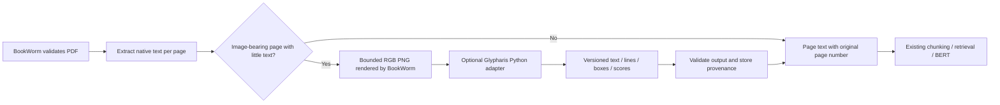

# Glypharis integration contract and rollout

Reviewed 2026-10-12 against [Glypharis commit 7cb784d](https://github.com/DuhItzAniket/Glypharis/tree/7cb784d471dabe0efcf495a3b397f9110429c8af). This document changes BookWorm only; Glypharis development remains in its own repository.

## What the upstream repository actually provides

The [README](https://github.com/DuhItzAniket/Glypharis/blob/7cb784d471dabe0efcf495a3b397f9110429c8af/README.md) reports Phase 3 (data audit), with no trained model. The package exports only its version at this revision. The `GlypharisOCR` inference API is a **target**, not a working release.

The [architecture](https://github.com/DuhItzAniket/Glypharis/blob/7cb784d471dabe0efcf495a3b397f9110429c8af/docs/ARCHITECTURE.md) defines an image-to-text engine with line boxes, scores, timing and model version. It deliberately knows nothing about PDFs or QA. The [v0.1 decision](https://github.com/DuhItzAniket/Glypharis/blob/7cb784d471dabe0efcf495a3b397f9110429c8af/docs/decisions/ADR-0008-usable-engine-first.md) targets CPU-first ONNX inference and a usable package after phases 10, 17, 18 and 20. The optional HTTP API arrives later; its request/auth/error contract is not yet specified.

## Responsibilities



BookWorm owns PDF parsing, page numbers, rendering, storage, limits and citations. Glypharis owns preprocessing, detection, recognition and reading order. Do not move either project's application logic into the other. No pretrained third-party OCR is used as a fallback.

## Implemented preparation

- `OCR_PROVIDER=disabled` by default; normal native-text documents do not import or load Glypharis.
- `OCRProvider.predict(Path) -> dict` is the internal boundary. `GlypharisProvider` lazily calls the planned `GlypharisOCR.from_pretrained(GLYPHARIS_MODEL_PATH)` and `predict(path).to_dict()` API, serializing load/inference.
- Image-bearing PDF pages with fewer than `OCR_MIN_NATIVE_CHARS` (default 40) are candidates. This is a heuristic: it may miss scanned body text beneath a long digital header, and cannot judge a corrupt but lengthy text layer. Blank pages without images are skipped. A mixed PDF is rejected if it needs OCR while OCR is disabled, rather than silently omitting its scanned chapter.
- Candidates render one at a time, RGB at 150 DPI, with an 8 million pixel limit and a five-page OCR cap. Temporary images are removed. These are resource safeguards, not measured Glypharis latency targets.
- The adapter validates bounded text, line count, finite scores in [0, 1], finite boxes inside the rendered image, nonempty text/lines, timing and model version. Unknown upstream fields are tolerated. Original PDF page numbering overrides any upstream page number.
- A new `page_extractions` table stores OCR lines/boxes, scores, model version, image dimensions, render DPI and review marker in the same transaction as the document. `create_all` adds this table without changing existing tables. Existing native documents continue working.
- QA citations identify Glypharis output and warn that OCR text should be checked against the original. OCR confidence is kept separate from BERT answer score and is treated as unverified/raw. Low-confidence lines are retained; no unvalidated score is used to silently remove content.
- No OCR HTTP server, package pin, model download, weights or trained OCR performance is claimed. Contract tests use **test-only fake output**.

## Expected upstream result

```json
{
  "text": "Recognized text in reading order",
  "lines": [{"text": "Recognized text in reading order", "confidence": 0.8,
             "bbox": [12, 40, 610, 72], "polygon": [[12,40],[610,40],[610,72],[12,72]]}],
  "processing_time_ms": 142,
  "model_version": "release identifier"
}
```

Before release, confirm these open points with the actual package: bbox units must be original input-image pixels, not resized detector coordinates; `text` and line reading order must agree; release/device selection and `from_pretrained` behavior must be stable; errors and unsupported inputs must be documented; raw/calibrated score semantics must be versioned. The current docs do not guarantee all of these details. If the actual API changes, adapt only this bridge and its tests.

## Integration gate when v0.1 is ready

1. Pin a release/tag or immutable revision, verify weight provenance and licence, and install it in an isolated backend environment. Do not install the moving upstream main branch into production.
2. Run Glypharis's CPU/ONNX equivalence and input-hardening checks. Run one PNG through the public API and compare `to_dict()` with the schema above.
3. Configure `GLYPHARIS_MODEL_PATH` and `OCR_PROVIDER=glypharis` on a staging backend. No Vercel/browser model configuration is needed.
4. Test real single-page scans, mixed PDFs, blank pages, multi-column text, low quality scans and malformed output. Verify page citations and stored box coordinates against images.
5. Measure OCR CER/WER, end-to-end QA EM/F1, abstention, memory, cold/warm latency, and the effect of recognition errors. Fake tests establish plumbing only.
6. If five-page synchronous ingestion cannot reliably finish within browser/host timeouts, add a persistent job queue and status polling before increasing the limit. Local inference has no hard cancellation timeout today.
7. Record the exact release, validation report and deployment commit, then enable the feature. Restart to change model/provider configuration. Disable `OCR_PROVIDER` to stop new OCR ingestion; existing OCR-derived text remains answerable with provenance.

Long scans and standalone image uploads are deferred. The initial integration supports scanned PDF pages only. A future remote adapter can implement the same internal protocol once Glypharis publishes an HTTP request/auth/error contract; no guessed `/ocr` client is committed now. Shared GPU training in Glypharis is unaffected because BookWorm defaults to CPU and does not start any OCR training.
